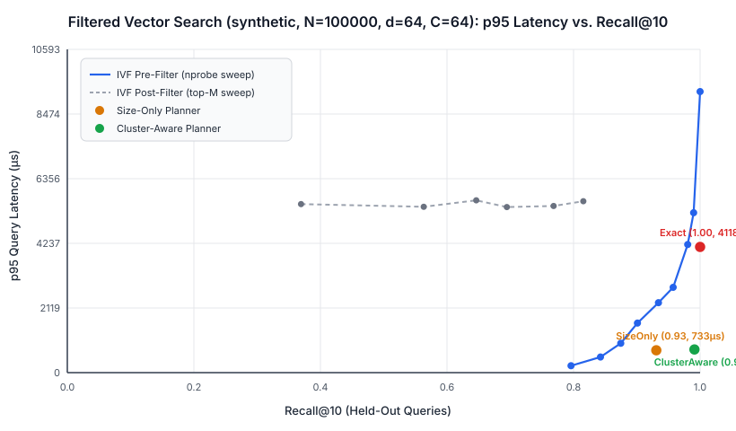
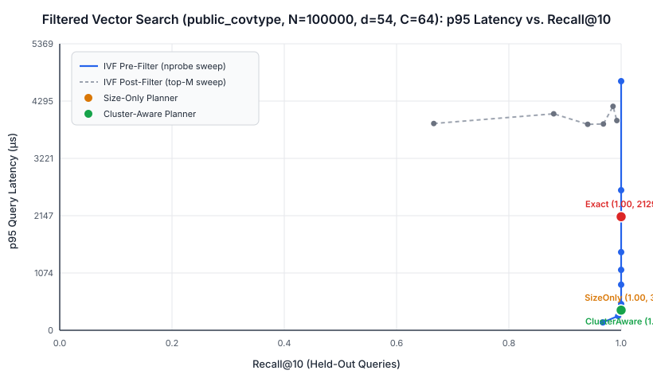

# Filtered Vector Search Under Load

Single-node filtered vector search engine in Go. Given a query embedding, a category equality filter (`category`), and `k`, the engine returns the `k` closest vectors among documents in that category.

The engine compares five execution strategies on held-out queries across both a synthetic stress workload and a public real-world corpus (**UCI Forest Covertype**, `54D`, 7 ecological `cover_type` categories):
1. **Exact Category Scan (`ExactIndex`)**: Scans only the contiguous vectors in `byCategory[category]` using a typed size-`k` max-heap.
2. **IVF Post-Filter (`IVFIndex.SearchPostFilter`)**: Scores all vectors in the `nprobe` nearest clusters for global top-$M$ ($M \in \{10, 25, 50, 100, 250, 500\}$), then filters by `category`.
3. **IVF Pre-Filter (`IVFIndex.SearchPreFilter`)**: Probes a fixed `nprobe` budget ($1 \dots 64$) and checks `doc.Category == category` before computing vector distance.
4. **Size-Only Planner (`SizeOnlyPlanner`)**: Routes rare categories ($\le \text{MaxExactSelectivity}$) to `ExactIndex` and all larger categories to `IVFIndex` with a fixed `BaseNProbe`.
5. **Cluster-Aware Planner (`ClusterAwarePlanner`)**: Inspects per-centroid category histograms (`categoryHistograms[category][cluster]`) along the query's ranked centroids to skip clusters with zero eligible documents, expand `nprobe` when nearby clusters are sparse, stop early when nearby clusters are dense, or fall back to `ExactIndex` when nearby clusters cannot fill `k`.

---

## Fresh-Clone Quickstart

```bash
git clone https://github.com/colinsohn/filtered-vector-search.git
cd filtered-vector-search

# 1. Run unit, parity, dev-tuning, public-corpus, cancellation, and race-detector tests
go test -race -v ./...

# 2. Run small reproducible benchmark on both corpora (N=20,000, synthetic + public UCI Covertype)
go run ./cmd/bench -scale small -corpus both

# 3. Run full benchmark on both corpora (N=100,000, synthetic + public UCI Covertype)
go run ./cmd/bench -scale full -corpus both
```

Machine-readable JSON reports and SVG charts are written to:
- Synthetic (`N=20k` / `N=100k`): [`results/benchmark_small.json`](results/benchmark_small.json), [`results/benchmark_full.json`](results/benchmark_full.json), [`results/recall_latency_small.svg`](results/recall_latency_small.svg), [`results/recall_latency_full.svg`](results/recall_latency_full.svg)
- Public UCI Forest Covertype (`N=20k` / `N=100k`): [`results/benchmark_public_covtype_small.json`](results/benchmark_public_covtype_small.json), [`results/benchmark_public_covtype_full.json`](results/benchmark_public_covtype_full.json), [`results/recall_latency_public_covtype_small.svg`](results/recall_latency_public_covtype_small.svg), [`results/recall_latency_public_covtype_full.svg`](results/recall_latency_public_covtype_full.svg)

---

## Reproducible Planner Tuning on Development Queries (`v0.2`)

Before any held-out query is evaluated, [`TunePlannersOnDevQueries`](planner.go) sweeps candidate parameter grids for both `SizeOnlyPlanner` (`6` configurations) and `ClusterAwarePlanner` (`72` configurations) exclusively on the disjoint `200`-query development split (`DevQueries`, target `Recall@10 = 0.97`).

For each planner, the tuner selects the configuration that minimizes mean evaluated vectors subject to meeting the target recall and zero underfill on `DevQueries` (falling back to highest dev recall if a constrained planner family cannot reach the target), freezes the resulting hyperparameters inside `PlannerTuningReport`, and evaluates `HeldOutQueries` (`500` unseen queries) without touching the planner settings again. Verified in [`TestPlannerTuningOnDevQueriesAndPublicCorpus`](search_test.go#L658-L729).

| Workload (`N=100,000`) | Frozen `SizeOnlyPlanner` (Dev-Tuned) | Frozen `ClusterAwarePlanner` (Dev-Tuned) |
| --- | --- | --- |
| **Synthetic (`64D`)** | `MaxExactSel=0.010, BaseNProbe=3` (`dev recall=0.9464`, `eval=2117.9`) | `MaxExactSel=0.010, BaseNProbe=3, MaxNProbe=10, TargetMultK=10, MaxRatio=8` (`dev recall=0.9875`, `eval=2585.2`) |
| **Public UCI Covertype (`54D`)** | `MaxExactSel=0.010, BaseNProbe=3` (`dev recall=0.9980`, `eval=1716.1`) | `MaxExactSel=0.010, BaseNProbe=3, MaxNProbe=10, TargetMultK=10, MaxRatio=12` (`dev recall=0.9990`, `eval=1736.1`) |

---

## Workload 1: Synthetic Stress Benchmark (`N=100,000`, `dim=64`, `clusters=64`, `k=10`)

- **Index Build Time**: `5,573.6 ms` | **Index Heap Footprint**: `55.22 MB`
- **Queries**: `200` development queries (used to freeze planner thresholds) and `500` held-out queries (`480` non-empty filters + `20` empty-filter checks; 1 warmup pass + 3 timed passes).



### Overall Held-Out Comparison (Synthetic `N=100,000`)

| Method | Recall@10 | Underfill Rate | Mean Evaluated | p50 (µs) | p95 (µs) | QPS |
| --- | --- | --- | --- | --- | --- | --- |
| `exact` | `1.0000` | `0.0000` | `17520.8` | `146.7` | `4117.9` | `1121` |
| `size_only_planner` | `0.9308` | `0.0667` | `2127.5` | `71.2` | `732.7` | `5964` |
| **`cluster_aware_planner`** | **`0.9910`** | **`0.0000`** | **`2643.5`** | **`124.8`** | **`760.5`** | **`5006`** |
| `ivf_prefilter_nprobe_1` | `0.7960` | `0.1688` | `754.5` | `33.0` | `227.2` | `15118` |
| `ivf_prefilter_nprobe_2` | `0.8425` | `0.1500` | `1412.1` | `51.7` | `512.0` | `8311` |
| `ivf_prefilter_nprobe_4` | `0.8746` | `0.1125` | `2718.1` | `82.6` | `961.3` | `4572` |
| `ivf_prefilter_nprobe_8` | `0.9010` | `0.0771` | `4301.7` | `118.3` | `1622.8` | `2727` |
| `ivf_prefilter_nprobe_12` | `0.9342` | `0.0437` | `5557.1` | `166.5` | `2291.7` | `1911` |
| `ivf_prefilter_nprobe_16` | `0.9575` | `0.0271` | `6674.0` | `183.3` | `2795.8` | `1594` |
| `ivf_prefilter_nprobe_24` | `0.9804` | `0.0146` | `8707.5` | `246.2` | `4198.6` | `1061` |
| `ivf_prefilter_nprobe_32` | `0.9898` | `0.0042` | `10640.9` | `283.3` | `5241.2` | `852` |
| `ivf_prefilter_nprobe_64` | `1.0000` | `0.0000` | `17520.8` | `474.6` | `9210.9` | `482` |
| `ivf_postfilter_nprobe_8_top_10` | `0.3694` | `0.8979` | `23890.9` | `4457.4` | `5522.3` | `226` |
| `ivf_postfilter_nprobe_8_top_25` | `0.5633` | `0.5833` | `23890.9` | `4458.0` | `5435.3` | `226` |
| `ivf_postfilter_nprobe_8_top_50` | `0.6462` | `0.4583` | `23890.9` | `4496.0` | `5646.6` | `223` |
| `ivf_postfilter_nprobe_8_top_100` | `0.6946` | `0.3812` | `23890.9` | `4462.8` | `5424.8` | `226` |
| `ivf_postfilter_nprobe_8_top_250` | `0.7685` | `0.3292` | `23890.9` | `4455.8` | `5460.3` | `225` |
| `ivf_postfilter_nprobe_8_top_500` | `0.8154` | `0.2208` | `23890.9` | `4488.0` | `5617.4` | `224` |

### Per-Category Breakdown (Synthetic `N=100,000`)

| Method | Category | Distribution | Docs | Recall@10 | Underfill Rate | Mean Evaluated | p95 (µs) | Exact / IVF Routes | Mean `nprobe` |
| --- | --- | --- | --- | --- | --- | --- | --- | --- | --- |
| `exact` | `cat_rare` | concentrated | 500 | `1.0000` | `0.0000` | `500.0` | `41.8` | `100 / 0` | `0.0` |
| `size_only_planner` | `cat_rare` | concentrated | 500 | `1.0000` | `0.0000` | `500.0` | `37.0` | `100 / 0` | `0.0` |
| `cluster_aware_planner` | `cat_rare` | concentrated | 500 | `1.0000` | `0.0000` | `500.0` | `36.5` | `100 / 0` | `0.0` |
| `exact` | `cat_concentrated` | concentrated (3/64 clusters) | 2500 | `1.0000` | `0.0000` | `2500.0` | `178.0` | `100 / 0` | `0.0` |
| `size_only_planner` | `cat_concentrated` | concentrated (3/64 clusters) | 2500 | `0.9010` | `0.0900` | `1058.4` | `144.5` | `0 / 100` | `3.0` |
| `cluster_aware_planner` | `cat_concentrated` | concentrated (3/64 clusters) | 2500 | **`0.9830`** | **`0.0000`** | `1622.4` | `182.7` | `0 / 100` | `2.0` |
| `exact` | `cat_dispersed` | dispersed (64/64 clusters) | 2500 | `1.0000` | `0.0000` | `2500.0` | `169.5` | `100 / 0` | `0.0` |
| `size_only_planner` | `cat_dispersed` | dispersed (64/64 clusters) | 2500 | `1.0000` | `0.0000` | `305.8` | `71.3` | `0 / 100` | `3.0` |
| `cluster_aware_planner` | `cat_dispersed` | dispersed (64/64 clusters) | 2500 | `1.0000` | `0.0000` | `314.5` | `71.8` | `0 / 100` | `3.1` |
| `exact` | `cat_medium` | concentrated (6/64 clusters) | 15000 | `1.0000` | `0.0000` | `15000.0` | `919.7` | `100 / 0` | `0.0` |
| `size_only_planner` | `cat_medium` | concentrated (6/64 clusters) | 15000 | `0.7670` | `0.2300` | `1289.2` | `296.0` | `0 / 100` | `3.0` |
| `cluster_aware_planner` | `cat_medium` | concentrated (6/64 clusters) | 15000 | **`0.9740`** | **`0.0000`** | `3193.2` | `402.8` | `0 / 100` | `2.8` |
| `exact` | `cat_common` | dispersed (64/64 clusters) | 79500 | `1.0000` | `0.0000` | `79500.0` | `4194.4` | `80 / 0` | `0.0` |
| `size_only_planner` | `cat_common` | dispersed (64/64 clusters) | 79500 | `1.0000` | `0.0000` | `8823.2` | `947.2` | `0 / 80` | `3.0` |
| `cluster_aware_planner` | `cat_common` | dispersed (64/64 clusters) | 79500 | **`1.0000`** | **`0.0000`** | `8823.2` | **`935.5`** | `0 / 80` | `3.0` |

---

## Workload 2: Public Corpus with Real Category Labels — UCI Forest Covertype (`N=100,000`, `dim=54`, `clusters=64`, `k=10`)

Implemented in [`public_corpus.go`](public_corpus.go): downloads and SHA-256-verifies the [UCI Forest Covertype (`covtype`)](https://archive.ics.uci.edu/dataset/31/covertype) dataset (`CC BY 4.0`, Blackard & Dean 1998, `581,012` cartographic forest observation rows), z-score standardizes and L2-normalizes the `54` cartographic features using corpus statistics, and partitions disjoint corpus (`N=100,000` or `N=20,000`), development (`200` queries), and held-out (`500` queries) splits across all **7 real ecological `cover_type` categories**:
- `cottonwood_willow` (`0.45%` of corpus, concentrated in `10/64` clusters)
- `aspen` (`1.58%` of corpus, dispersed across `41/64` clusters)
- `douglas_fir` (`3.05%` of corpus, `25/64` clusters)
- `krummholz` (`3.62%` of corpus, dispersed across `41/64` clusters)
- `ponderosa_pine` (`6.13%` of corpus, concentrated in `16/64` clusters)
- `spruce_fir` (`36.33%` of corpus, dispersed across `61/64` clusters)
- `lodgepole_pine` (`48.84%` of corpus, dispersed across `63/64` clusters)



### Overall Held-Out Comparison (Public UCI Covertype `N=100,000`)

| Method | Recall@10 | Underfill Rate | Mean Evaluated | p50 (µs) | p95 (µs) | QPS |
| --- | --- | --- | --- | --- | --- | --- |
| `exact` | `1.0000` | `0.0000` | `14210.2` | `174.3` | `2128.6` | `1578` |
| `size_only_planner` | `0.9988` | `0.0020` | `1686.0` | `114.6` | `375.0` | `7351` |
| **`cluster_aware_planner`** | **`1.0000`** | **`0.0000`** | **`1711.9`** | **`114.3`** | **`377.8`** | **`7308`** |
| `ivf_prefilter_nprobe_1` | `0.9674` | `0.0080` | `743.3` | `49.5` | `147.8` | `16279` |
| `ivf_prefilter_nprobe_2` | `0.9946` | `0.0020` | `1200.4` | `74.0` | `268.5` | `10062` |
| `ivf_prefilter_nprobe_4` | `1.0000` | `0.0000` | `2020.6` | `125.2` | `492.4` | `6036` |
| `ivf_prefilter_nprobe_8` | `1.0000` | `0.0000` | `3309.4` | `161.3` | `854.9` | `3583` |
| `ivf_postfilter_nprobe_8_top_10` | `0.6662` | `0.7460` | `15689.1` | `2590.2` | `3874.8` | `368` |
| `ivf_postfilter_nprobe_8_top_100` | `0.9684` | `0.0780` | `15689.1` | `2579.3` | `3865.6` | `369` |
| `ivf_postfilter_nprobe_8_top_500` | `0.9924` | `0.0220` | `15689.1` | `2591.0` | `3930.1` | `367` |

### Per-Category Breakdown (Public UCI Covertype `N=100,000` & `N=20,000`)

| Scale | Method | Category (`cover_type`) | Cluster Spread | Docs | Recall@10 | Underfill Rate | Mean Evaluated | p95 (µs) | Exact / IVF Routes | Mean `nprobe` |
| --- | --- | --- | --- | --- | --- | --- | --- | --- | --- | --- |
| `100k` | `exact` | `cottonwood_willow` | concentrated (`10/64`) | `450` | **`1.0000`** | `0.0000` | `450.0` | **`29.1`** | `72 / 0` | `0.0` |
| `100k` | `cluster_aware_planner` | `cottonwood_willow` | concentrated (`10/64`) | `450` | `1.0000` | `0.0000` | `450.0` | `31.6` | `72 / 0` | `0.0` |
| `20k` | `exact` | `aspen` | dispersed (`35/64`) | `323` | **`1.0000`** | `0.0000` | `323.0` | **`18.6`** | `72 / 0` | `0.0` |
| `20k` | `size_only_planner` | `aspen` | dispersed (`35/64`) | `323` | `0.8917` | `0.0833` | `42.6` | `15.0` | `0 / 72` | `3.0` |
| `20k` | `cluster_aware_planner` | `aspen` | dispersed (`35/64`) | `323` | `0.9958` | `0.0000` | `136.8` | `23.2` | `10 / 62` | `7.1` |
| `100k` | `exact` | `krummholz` | dispersed (`41/64`) | `3618` | `1.0000` | `0.0000` | `3618.0` | `202.5` | `71 / 0` | `0.0` |
| `100k` | `size_only_planner` | `krummholz` | dispersed (`41/64`) | `3618` | `0.9915` | `0.0141` | `760.5` | `105.2` | `0 / 71` | `3.0` |
| `100k` | `cluster_aware_planner` | `krummholz` | dispersed (`41/64`) | `3618` | **`1.0000`** | **`0.0000`** | `771.6` | **`108.0`** | `0 / 71` | `3.2` |
| `100k` | `exact` | `ponderosa_pine` | concentrated (`16/64`) | `6132` | `1.0000` | `0.0000` | `6132.0` | `345.3` | `71 / 0` | `0.0` |
| `100k` | `cluster_aware_planner` | `ponderosa_pine` | concentrated (`16/64`) | `6132` | **`1.0000`** | **`0.0000`** | `2517.7` | **`240.9`** | `0 / 71` | `3.0` |
| `100k` | `exact` | `spruce_fir` | dispersed (`61/64`) | `36331` | `1.0000` | `0.0000` | `36331.0` | `1638.4` | `71 / 0` | `0.0` |
| `100k` | `cluster_aware_planner` | `spruce_fir` | dispersed (`61/64`) | `36331` | **`1.0000`** | **`0.0000`** | `2524.2` | **`361.1`** | `0 / 71` | `3.0` |
| `100k` | `exact` | `lodgepole_pine` | dispersed (`63/64`) | `48843` | `1.0000` | `0.0000` | `48843.0` | `2189.2` | `71 / 0` | `0.0` |
| `100k` | `cluster_aware_planner` | `lodgepole_pine` | dispersed (`63/64`) | `48843` | **`1.0000`** | **`0.0000`** | `3940.8` | **`548.3`** | `0 / 71` | `3.0` |

---

## Where `ClusterAwarePlanner` Wins vs. Where `ExactIndex` Wins

1. **Where `ExactIndex` Wins (Low-Cardinality & Sparse-Borderline Categories)**:
   - On rare categories (`cottonwood_willow`, `450` docs / `0.45%` of `100k` corpus; `cat_rare`, `500` docs), `ExactIndex` iterates sequentially over a single contiguous `byCategory[category]` slice in **`p95 = 29.1 µs`** (`7.6 µs` at `N=20k`) with guaranteed `1.0000` recall and zero centroid-ranking overhead.
   - On borderline low-cardinality dispersed categories (`aspen` at `N=20k`, `323` docs / `1.6%` of corpus spread across `35/64` clusters), `ExactIndex` finishes in **`p95 = 18.6 µs` at `1.0000` recall**, beating `ClusterAwarePlanner` (`p95 = 23.2 µs`, `0.9958` recall), because ranking `64` centroids plus probing `7.1` scattered cluster posting lists costs more CPU and cache misses than scanning `323` contiguous vectors directly.
   - Similarly, on `cat_concentrated` at `N=100k` (`2,500` docs packed into `3` clusters), `ExactIndex` (`p95 = 178.0 µs`, `1.0000` recall) is slightly faster at the tail than `ClusterAwarePlanner` (`p95 = 182.7 µs`, `0.9830` recall) because scanning 2 concentrated clusters of `~1,622` non-contiguous candidates plus ranking `64` centroids matches the cost of scanning `2,500` contiguous category vectors.
2. **Where `ClusterAwarePlanner` Wins (Medium-to-Large Categories & Dispersed vs. Concentrated Skews)**:
   - **Overall Latency & Throughput**: On `N=100k` Public UCI Covertype, `ClusterAwarePlanner` achieves **`1.0000` Recall@10** and **`0.00%` underfill** at **`p95 = 377.8 µs` (`7,308 QPS`)** — **5.6x lower p95 latency and 4.6x higher QPS** than `ExactIndex` (`p95 = 2,128.6 µs`, `1,578 QPS`). On `N=100k` Synthetic, `ClusterAwarePlanner` achieves **`0.9910` Recall@10** (`0.00%` underfill) at **`p95 = 760.5 µs` (`5,006 QPS`)** — **5.4x lower p95 latency** than `ExactIndex` (`4,117.9 µs`) and **6.9x lower p95 latency** than fixed-budget IVF at comparable recall (`nprobe=32`, `0.9898` recall, `p95 = 5,241.2 µs`).
   - **High-Selectivity Categories**: On `spruce_fir` (`36,331` docs) and `lodgepole_pine` (`48,843` docs), `ClusterAwarePlanner` cuts p95 latency from `1,638.4 µs` and `2,189.2 µs` (`ExactIndex`) down to **`361.1 µs` (4.5x faster)** and **`548.3 µs` (4.0x faster)** while maintaining `1.0000` recall.
   - **Eliminating `SizeOnlyPlanner` Underfill**: On `krummholz` (`3,618` docs across `41/64` clusters at `100k`) and `aspen` (`323` docs across `35/64` clusters at `20k`), `SizeOnlyPlanner` suffers `1.41%` and `8.33%` underfill (`0.8917` recall on `20k aspen`) because a fixed `nprobe=3` lands on clusters with fewer than `k=10` matching trees. `ClusterAwarePlanner` inspects `categoryHistograms[category][cluster]` to expand `nprobe` only on sparse queries, eliminating underfill (`0.00%`) and lifting `20k aspen` recall from `0.8917` to `0.9958` and `100k krummholz` recall from `0.9915` to `1.0000`.

---

## Concurrent HTTP Service Load Test (`POST /search`)

In-process engine execution timing (`engine_duration_us`) is measured inside [`SearchServer.handleSearch`](server.go#L88-L90) separately from client-observed end-to-end HTTP round-trip latency:

| Workload (`N=100k`) | Mode | Workers | Max In-Flight | Succeeded | Rejected (`429`) | Timed Out | Throughput (QPS) | Engine p50 / p95 (µs) | HTTP Client p50 / p95 (µs) |
| --- | --- | --- | --- | --- | --- | --- | --- | --- | --- |
| **Synthetic (`64D`)** | Normal | 8 | 16 | 1000 | 0 | 0 | `15,986` | `155.6 / 1169.0` | `286.4 / 1356.4` |
| **Synthetic (`64D`)** | Saturated | 16 | 2 | 26 | 974 | 0 | `2,627` | `266.5 / 2089.8` | `452.2 / 2173.0` |
| **UCI Covertype (`54D`)** | Normal | 8 | 16 | 1000 | 0 | 0 | `22,176` | `142.2 / 734.0` | `263.4 / 887.9` |
| **UCI Covertype (`54D`)** | Saturated | 16 | 2 | 63 | 937 | 0 | `5,936` | `176.9 / 749.5` | `354.2 / 1101.3` |

---

## Worked Example Where `ClusterAwarePlanner` Chooses Poorly

Verified in [`TestClusterAwarePlannerFailureCase`](search_test.go#L593-L656):
- **Setup**:
  - **Cluster 0** (centroid at `(-1.0, 0)`) holds `50` documents of `"target_cat"` at `(-1.0, 0)`.
  - **Cluster 1** (centroid at `~ (10.4, 0)`) holds `49` `"other"` documents at `(10.5, 0)` plus `1` `"target_cat"` boundary document (`"target-boundary-winner"`) at `(5.5, 0)`.
- **Query**: `q = (4.0, 0)`, `category = "target_cat"`, `k = 1`.
- **Why the planner fails**:
  - `q = (4.0, 0)` is closer to Cluster 0's centroid (`distSq = 25.0`) than Cluster 1's centroid (`distSq = 40.96`).
  - Inspecting `categoryHistograms["target_cat"][0] = 50` tells `ClusterAwarePlanner` that Cluster 0 alone already satisfies its candidate count target (`50 >= targetEligible`), so it stops after probing only Cluster 0 (`nprobe = 1`) and returns `target-c0-00` (`distSq = 25.0`, **`Recall@1 = 0.00`**), missing `"target-boundary-winner"` in Cluster 1 (`distSq = 2.25`).
- **Root cause**: Per-centroid category histograms capture **cardinality** per cluster, not the spatial spread or boundary proximity of eligible vectors within neighboring clusters.

---

## Profiling & Measured Optimization (`go tool pprof`)

Profiling `BenchmarkExactSearch` and `BenchmarkIVFPreFilterSearch` (`N=10,000, d=64, C=64, k=10`) with `-cpuprofile` and `-memprofile` identified three hotspots:
1. `container/heap.Push` boxed every candidate `Result` into `any` (`interface{}`), causing 10–12 heap allocations per query.
2. `IVFIndex.rankClusters` allocated temporary `[]clusterDistance` and `[]int` slices on the heap on every query.
3. `squaredL2` executed single-element loop iterations.

Replacing `container/heap` with typed slice heap helpers (`pushResultHeap` / `siftDownResultHeap`), stack-allocating the cluster ranking buffer (`var stackRanked [128]clusterDistance`), and unrolling `squaredL2` 4-wide with left-associative accumulation produced:

| Benchmark | Before (`ns/op`) | After (`ns/op`) | Speedup | Before (`B/op`, `allocs/op`) | After (`B/op`, `allocs/op`) |
| --- | --- | --- | --- | --- | --- |
| `BenchmarkExactSearch-8` | `228,655 ns/op` | `129,245 ns/op` | **1.77x faster (-43.5%)** | `504 B/op`, `12 allocs/op` | `240 B/op`, **`1 allocs/op`** |
| `BenchmarkIVFPreFilterSearch-8` | `27,679 ns/op` | `19,135 ns/op` | **1.45x faster (-30.9%)** | `1,560 B/op`, `14 allocs/op` | `240 B/op`, **`1 allocs/op`** |
