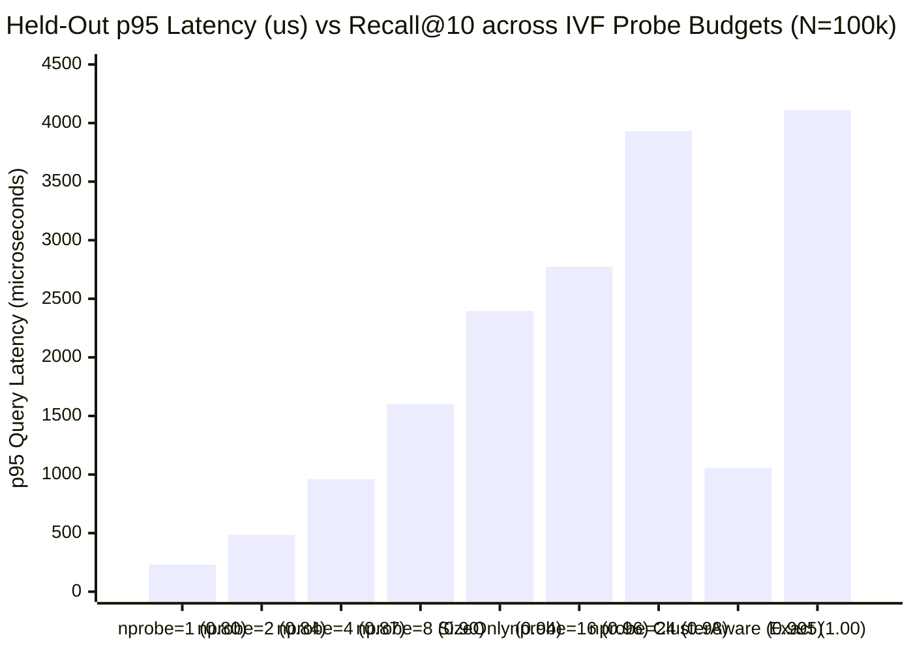

# Filtered Vector Search Under Load

Single-node filtered vector search engine in Go. Given a query embedding, a category equality filter (`category`), and `k`, the engine returns the `k` closest vectors among documents in that category.

The engine compares five execution strategies on held-out queries:
1. **Exact Category Scan (`ExactIndex`)**: Scans only the contiguous vectors in `byCategory[category]` using a typed size-`k` max-heap.
2. **IVF Post-Filter (`IVFIndex.SearchPostFilter`)**: Scores all vectors in the `nprobe` nearest clusters for global top-$M$ ($M \in \{10, 25, 50, 100, 250, 500\}$), then filters by `category`.
3. **IVF Pre-Filter (`IVFIndex.SearchPreFilter`)**: Probes a fixed `nprobe` budget ($1 \dots 64$) and checks `doc.Category == category` before computing vector distance.
4. **Size-Only Planner (`SizeOnlyPlanner`)**: Routes rare categories ($\le 1.5\%$ of corpus) to `ExactIndex` and all larger categories to `IVFIndex` with a fixed `nprobe = 4`.
5. **Cluster-Aware Planner (`ClusterAwarePlanner`)**: Inspects per-centroid category histograms (`categoryHistograms[category][cluster]`) along the query's ranked centroids to skip clusters with zero eligible documents, expand `nprobe` when nearby clusters are sparse (`cat_dispersed`), stop early when nearby clusters are dense (`cat_concentrated`), or fall back to `ExactIndex` when nearby clusters cannot fill `k`.

---

## Fresh-Clone Quickstart

```bash
git clone https://github.com/colinsohn/filtered-vector-search.git
cd filtered-vector-search

# 1. Run unit, parity, planner, cancellation, and race-detector tests
go test -race -v ./...

# 2. Run small reproducible benchmark (N=20,000, d=64, C=64, k=10)
go run ./cmd/bench -scale small

# 3. Run full benchmark (N=100,000, d=64, C=64, k=10)
go run ./cmd/bench -scale full
```

Machine-readable JSON reports and SVG charts are written to [`results/benchmark_small.json`](file:///Users/colinsohn/filtered-vector-search/results/benchmark_small.json), [`results/benchmark_full.json`](file:///Users/colinsohn/filtered-vector-search/results/benchmark_full.json), [`results/recall_latency_small.svg`](file:///Users/colinsohn/filtered-vector-search/results/recall_latency_small.svg), and [`results/recall_latency_full.svg`](file:///Users/colinsohn/filtered-vector-search/results/recall_latency_full.svg).

---

## Measured Results (`N=100,000`, `dim=64`, `clusters=64`, `k=10`, Apple M2, Go 1.27)

- **Index Build Time**: `5,544.1 ms` | **Index Heap Footprint**: `55.22 MB`
- **Queries**: `200` development queries (used to freeze planner thresholds) and `500` held-out queries (`480` non-empty filters + `20` empty-filter checks; 1 warmup pass + 3 timed passes).

### Held-Out Recall@10 vs. p95 Latency Chart




### 1. Overall Strategy Comparison (`N=100,000` Held-Out)

| Method | Recall@10 | Underfill Rate | Mean Evaluated | p50 (µs) | p95 (µs) | QPS |
| --- | --- | --- | --- | --- | --- | --- |
| `exact` | `1.0000` | `0.0000` | `17520.8` | `146.2` | `4111.5` | `1112` |
| `size_only_planner` | `0.9371` | `0.0521` | `2783.6` | `158.8` | `2394.7` | `1810` |
| **`cluster_aware_planner`** | **`0.9946`** | **`0.0000`** | **`2721.9`** | **`140.9`** | **`1057.3`** | **`3406`** |
| `ivf_prefilter_nprobe_1` | `0.7960` | `0.1688` | `754.5` | `32.4` | `231.9` | `15488` |
| `ivf_prefilter_nprobe_2` | `0.8425` | `0.1500` | `1412.1` | `50.3` | `485.0` | `8607` |
| `ivf_prefilter_nprobe_4` | `0.8746` | `0.1125` | `2718.1` | `82.9` | `960.3` | `4595` |
| `ivf_prefilter_nprobe_8` | `0.9010` | `0.0771` | `4301.7` | `116.8` | `1600.0` | `2794` |
| `ivf_prefilter_nprobe_12` | `0.9342` | `0.0437` | `5557.1` | `158.6` | `2205.5` | `2050` |
| `ivf_prefilter_nprobe_16` | `0.9575` | `0.0271` | `6674.0` | `182.2` | `2774.3` | `1625` |
| `ivf_prefilter_nprobe_24` | `0.9804` | `0.0146` | `8707.5` | `230.5` | `3930.4` | `1144` |
| `ivf_prefilter_nprobe_32` | `0.9898` | `0.0042` | `10640.9` | `280.8` | `5078.9` | `888` |
| `ivf_prefilter_nprobe_64` | `1.0000` | `0.0000` | `17520.8` | `486.9` | `9296.0` | `478` |
| `ivf_postfilter_nprobe_8_top_10` | `0.3694` | `0.8979` | `23890.9` | `4485.8` | `5297.3` | `225` |
| `ivf_postfilter_nprobe_8_top_25` | `0.5633` | `0.5833` | `23890.9` | `4509.5` | `5450.5` | `224` |
| `ivf_postfilter_nprobe_8_top_50` | `0.6462` | `0.4583` | `23890.9` | `4528.2` | `5373.0` | `223` |
| `ivf_postfilter_nprobe_8_top_100` | `0.6946` | `0.3812` | `23890.9` | `4471.9` | `5318.8` | `226` |
| `ivf_postfilter_nprobe_8_top_250` | `0.7685` | `0.3292` | `23890.9` | `4472.6` | `5272.3` | `226` |
| `ivf_postfilter_nprobe_8_top_500` | `0.8154` | `0.2208` | `23890.9` | `5078.6` | `10696.1` | `167` |

- **Comparable-Recall Comparison (~0.99 Recall@10)**:
  - Fixed-budget IVF needs `nprobe = 32` to reach `Recall@10 = 0.9898`, evaluating `10,640.9` candidates with **`p95 = 5,078.9 µs`** (`0.42%` underfill).
  - `cluster_aware_planner` reaches **`Recall@10 = 0.9946`** with **`0.00%` underfill**, evaluating `2,721.9` candidates at **`p95 = 1,057.3 µs`** (**4.8x lower p95 latency** than fixed-budget IVF at comparable recall, and **3.9x lower p95 latency** than `exact`).

### 2. Equal-Sized Categories: Concentrated vs. Dispersed Breakdown

At `N=20,000` (`small` scale, `500` docs each in `cat_concentrated` and `cat_dispersed`):

| Planner | Category | Cluster Spread | Docs | Recall@10 | Underfill Rate | Mean Evaluated | p95 (µs) | Mean `nprobe` |
| --- | --- | --- | --- | --- | --- | --- | --- | --- |
| `size_only_planner` | `cat_concentrated` | 3 of 64 clusters | 500 | `0.8400` | `0.1600` | `159.1` | `32.4` | `4.0` |
| `cluster_aware_planner` | `cat_concentrated` | 3 of 64 clusters | 500 | **`0.9950`** | **`0.0000`** | `333.3` | `37.2` | `2.4` |
| `size_only_planner` | `cat_dispersed` | All 64 clusters | 500 | `0.9020` | `0.0100` | `55.6` | `17.1` | `4.0` |
| `cluster_aware_planner` | `cat_dispersed` | All 64 clusters | 500 | **`0.9480`** | **`0.0000`** | `89.8` | `20.5` | `6.4` |

- `size_only_planner` sees `500` documents for both categories and blindly probes the `4` nearest centroids (`Mean nprobe = 4.0`). On off-cluster `cat_concentrated` queries, those 4 centroids contain zero eligible documents (`16%` underfill). On `cat_dispersed`, 4 clusters hold too few eligible candidates (`0.9020` recall).
- `cluster_aware_planner` skips zero-count clusters on `cat_concentrated` (`Mean nprobe = 2.4`, `0.9950` recall, `0%` underfill) and expands `nprobe` to `6.4` non-empty clusters on `cat_dispersed` (`0.9480` recall, `0%` underfill).

### 3. Concurrent HTTP Service Load Test (`POST /search`)

In-process engine execution timing (`engine_duration_us`) is measured inside [`SearchServer.handleSearch`](file:///Users/colinsohn/filtered-vector-search/server.go#L88-L90) separately from client-observed end-to-end HTTP round-trip latency:

| Scale | Mode | Workers | Max In-Flight | Succeeded | Rejected (`429`) | Timed Out | Throughput (QPS) | Engine p50 / p95 (µs) | HTTP Client p50 / p95 (µs) |
| --- | --- | --- | --- | --- | --- | --- | --- | --- | --- |
| `small` (`N=20k`) | Normal | 8 | 16 | 1000 | 0 | 0 | `43,879` | `33.0 / 144.3` | `145.8 / 305.3` |
| `small` (`N=20k`) | Saturated | 16 | 2 | 226 | 774 | 0 | `19,585` | `42.2 / 170.8` | `201.0 / 496.7` |
| `full` (`N=100k`) | Normal | 8 | 16 | 1000 | 0 | 0 | `6,756` | `233.5 / 2552.5` | `673.4 / 3622.7` |
| `full` (`N=100k`) | Saturated | 16 | 2 | 46 | 954 | 0 | `2,326` | `337.2 / 2559.1` | `711.4 / 2833.5` |

---

## Worked Example Where `ClusterAwarePlanner` Chooses Poorly

Verified in [`TestClusterAwarePlannerFailureCase`](file:///Users/colinsohn/filtered-vector-search/search_test.go#L593-L656):
- **Setup**:
  - **Cluster 0** (centroid at `(-1.0, 0)`) holds `50` documents of `"target_cat"` at `(-1.0, 0)`.
  - **Cluster 1** (centroid at `~ (10.4, 0)`) holds `49` `"other"` documents at `(10.5, 0)` plus `1` `"target_cat"` boundary document (`"target-boundary-winner"`) at `(5.5, 0)`.
- **Query**: `q = (4.0, 0)`, `category = "target_cat"`, `k = 1`.
- **Why the planner fails**:
  - `q = (4.0, 0)` is closer to Cluster 0's centroid (`distSq = 25.0`) than Cluster 1's centroid (`distSq = 40.96`).
  - Inspecting `categoryHistograms["target_cat"][0] = 50` tells `ClusterAwarePlanner` that Cluster 0 alone already satisfies its candidate count target (`50 >= targetEligible`), so it stops after probing only Cluster 0 (`nprobe = 1`) and returns `target-c0-00` (`distSq = 25.0`, **`Recall@1 = 0.00`**), missing `"target-boundary-winner"` in Cluster 1 (`distSq = 2.25`).
- **Root cause**: Per-centroid category histograms capture **cardinality** per cluster, not the spatial spread or boundary proximity of eligible vectors within neighboring clusters.

---

## Profiling & Measured Optimization (`go tool pprof`)

Profiling `BenchmarkExactSearch` and `BenchmarkIVFPreFilterSearch` (`N=10,000, d=64, C=64, k=10`) with `-cpuprofile` and `-memprofile` identified three hotspots:
1. `container/heap.Push` boxed every candidate `Result` into `any` (`interface{}`), causing 10–12 heap allocations per query.
2. `IVFIndex.rankClusters` allocated temporary `[]clusterDistance` and `[]int` slices on the heap on every query.
3. `squaredL2` executed single-element loop iterations.

Replacing `container/heap` with typed slice heap helpers (`pushResultHeap` / `siftDownResultHeap`), stack-allocating the cluster ranking buffer (`var stackRanked [128]clusterDistance`), and unrolling `squaredL2` 4-wide with left-associative accumulation produced:

| Benchmark | Before (`ns/op`) | After (`ns/op`) | Speedup | Before (`B/op`, `allocs/op`) | After (`B/op`, `allocs/op`) |
| --- | --- | --- | --- | --- | --- |
| `BenchmarkExactSearch-8` | `228,655 ns/op` | `129,245 ns/op` | **1.77x faster (-43.5%)** | `504 B/op`, `12 allocs/op` | `240 B/op`, **`1 allocs/op`** |
| `BenchmarkIVFPreFilterSearch-8` | `27,679 ns/op` | `19,135 ns/op` | **1.45x faster (-30.9%)** | `1,560 B/op`, `14 allocs/op` | `240 B/op`, **`1 allocs/op`** |
